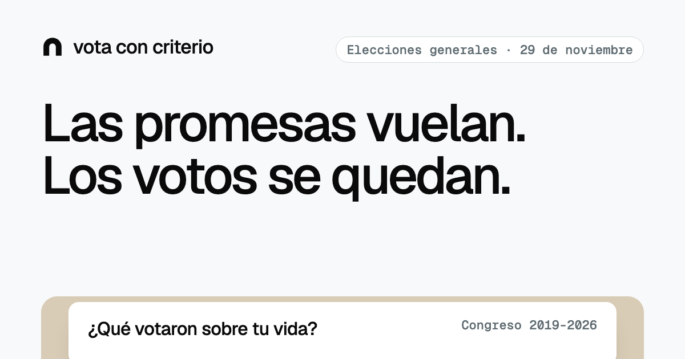
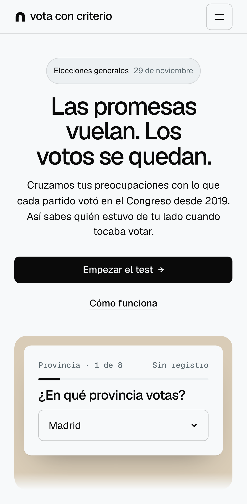
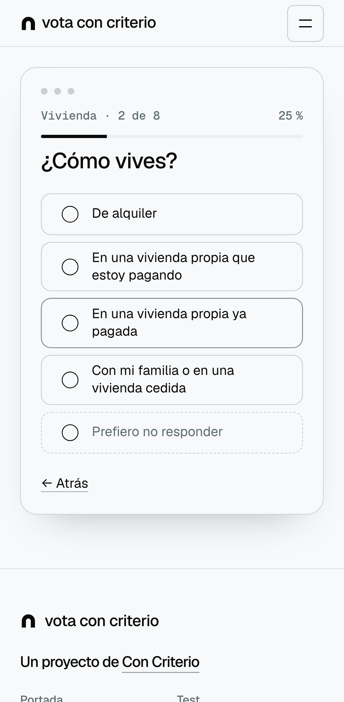
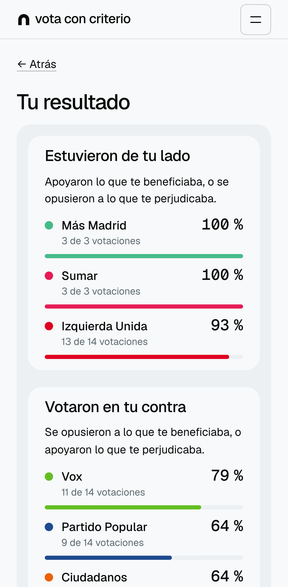
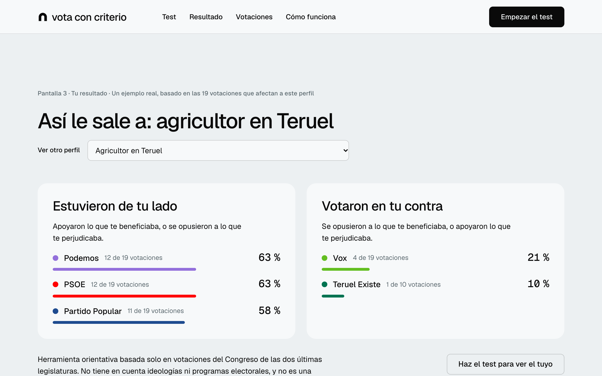
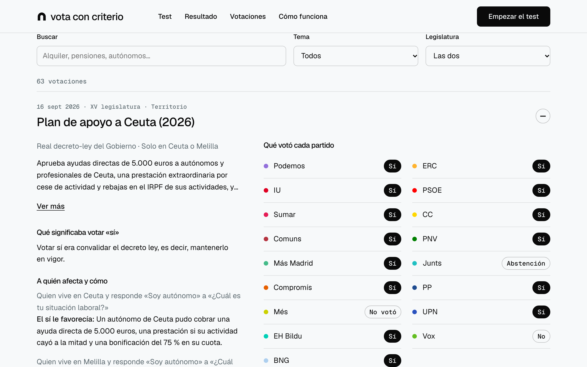
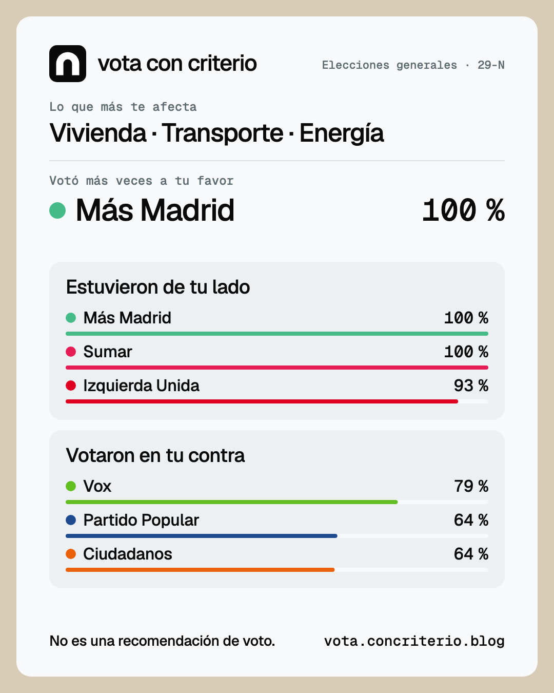
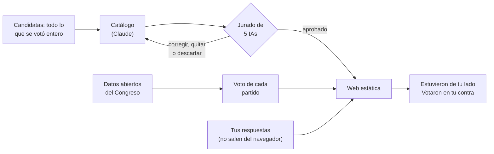

<p align="center">
  
</p>

<p align="center">
  <strong>Qué votó cada partido en el Congreso sobre tu vida, para las generales del 29 de noviembre de 2026.</strong>
</p>

<p align="center">
  
  
  
  
  <a href="./LICENSE"></a>
</p>

<p align="center">
  <a href="#pantallas">Pantallas</a> ·
  <a href="#cómo-funciona">Cómo funciona</a> ·
  <a href="#neutralidad">Neutralidad</a> ·
  <a href="#limitaciones">Limitaciones</a> ·
  <a href="#diseño">Diseño</a> ·
  <a href="#desarrollo">Desarrollo</a> ·
  <a href="#contribuir">Contribuir</a>
</p>

---

**Vota con Criterio** es una web anónima para las elecciones generales del 29 de noviembre de 2026.
Respondes unas preguntas sobre cómo vives —no sobre lo que opinas— y la web las cruza con una
selección de votaciones del Pleno del Congreso de las dos últimas legislaturas (XIV, 2019-2023, y
XV, 2023-2026) que cambiaban algo concreto para alguien como tú.

El resultado son dos podios: los partidos que **estuvieron de tu lado** y los que **votaron en tu
contra**, con cada votación explicada y enlazada a su fuente oficial. No es una encuesta ni una
recomendación de voto: es lo que quedó registrado.

Se publica en **[vota.concriterio.blog](https://vota.concriterio.blog)**, un proyecto de
[Con Criterio](https://concriterio.blog) firmado por Pol Marzà.

> **Las promesas vuelan. Los votos se quedan.** Los tests de afinidad comparan tus opiniones con lo
> que los partidos *dicen*. Este compara tu situación con lo que *votaron*.

---

## Pantallas

<table>
  <tr>
    <td width="33%"></td>
    <td width="33%"></td>
    <td width="33%"></td>
  </tr>
  <tr>
    <td align="center"><sub><b>Portada</b></sub></td>
    <td align="center"><sub><b>El test</b>: 8 preguntas básicas y 7 ampliadas</sub></td>
    <td align="center"><sub><b>Tu resultado</b></sub></td>
  </tr>
</table>

<p align="center">
  <br>
  <sub><b>Resultado de ejemplo en la portada</b>: el resultado real de uno de los nueve perfiles de referencia, elegido al azar en cada visita.</sub>
</p>

<p align="center">
  <br>
  <sub><b>Explorador del catálogo</b> (<code>/votaciones</code>): las 63 votaciones, con el voto de cada partido y filtros por texto, tema y legislatura.</sub>
</p>

<p align="center">
  <br>
  <sub><b>Tarjeta para compartir</b>: se genera en tu navegador; tu perfil solo sale si tú lo marcas.</sub>
</p>

---

## Cómo funciona



1. **Votos reales.** Se descargan todas las votaciones nominales de la XIV y la XV de los datos
   abiertos del Congreso. Cada voto cuenta para el partido del diputado en el momento de votar, y el
   voto de un partido es el de la mayoría de sus diputados presentes; si se dividió, se dice. Nunca
   se escribe a mano.
2. **El catálogo.** El universo son las iniciativas que se votaron enteras en el Pleno —leyes,
   decretos ley, proposiciones de cualquier grupo o parlamento autonómico y presupuestos—, se
   aprobaran o no. Partiendo de cada situación (alquiler, pensión, hijos, autónomos, quien
   contrata…) se eligen las que la afectan, **antes de mirar qué votó nadie**, y se etiquetan por lo
   que dice el texto oficial: un derecho, una ayuda, un impuesto o una obligación, con el artículo
   en que se basa y un extracto literal del BOE o del Boletín de las Cortes. **Un mismo efecto cuenta
   una sola vez.** Quedan 63 votaciones.
3. **Tu perfil.** Un bloque básico (provincia, vivienda, trabajo, edad, ingresos, hijos, cuidados,
   transporte) da un resultado provisional; uno ampliado (alquileres, contrato, campo,
   discapacidad, quien contrata, patrimonio, herencias) lo afina. Todas se pueden dejar sin
   responder, salvo la provincia.
4. **Tu resultado.** Para cada partido que se presenta en tu provincia, en cuántas de las
   votaciones que te afectan votó a tu favor y en cuántas en tu contra. Abstenciones y ausencias
   cuentan en el total pero no suman a ningún lado, así que los dos podios no suman 100. Debajo,
   todas las votaciones que lo explican.

El método completo está en [`docs/catalogo.md`](./docs/catalogo.md) y en la página
[Cómo funciona](https://vota.concriterio.blog/como-funciona).

---

## Neutralidad

| | |
|---|---|
| **Solo lo votado** | Nada de programas ni declaraciones: lo que cada partido votó, sacado de los datos oficiales. |
| **Elegido sin mirar el voto** | Las votaciones se eligen y se etiquetan por su texto; el voto de los partidos no entra hasta el cálculo. |
| **Jurado de IAs** | Claude selecciona y etiqueta; un jurado de cinco modelos de cinco empresas (OpenAI, Google, Mistral, DeepSeek y xAI) revisa cada efecto y cada resumen, a ciegas sobre quién propuso y quién votó qué. Sin mayoría, el efecto se quita o la votación no se publica, y el build falla si algo no tiene veredicto aprobado. Pol no interviene en las etiquetas. |
| **Veredicto publicado** | El jurado también juzga si el conjunto sirve para comparar partidos: hoy dice que **no está equilibrado** (dos de cada tres votaciones son del Gobierno; faltan leyes que el test no puede asignar a nadie). Se publica tal cual en "Cómo funciona". |
| **Trazable** | Cada votación enlaza a congreso.es y al texto oficial, cita el artículo y explica qué significaba votar «sí». Todas las respuestas del jurado, con sus razones, están en [`data/jurado/`](./data/jurado). |
| **Sin colores de nadie** | La interfaz es neutra: el color solo identifica a los partidos (sus colores oficiales, de la Wikipedia en español). |
| **Orden con fuente** | En el explorador, los partidos van de izquierda a derecha según la [Chapel Hill Expert Survey](https://www.chesdata.eu/) 2024 (2019 para Cs), no según criterio propio. |
| **Anónimo** | Las respuestas viven en la memoria de tu navegador: no van a la URL, ni a `localStorage`, ni a ningún servidor. Sin registro ni cookies. |

---

## Limitaciones

- Solo mira votaciones del Congreso: ni programas, ni promesas, ni gobiernos autonómicos, ni Senado.
- Es una selección de 63 votaciones entre cientos: otra selección daría otro resultado.
- Quien gobierna propone más leyes, y eso pesa. Votar contra un decreto entero cuenta como votar
  contra cada medida que lleva dentro.
- Solo cuenta lo que el test puede saber de ti: el ingreso mínimo vital, el teletrabajo o los
  derechos de las empleadas de hogar no caben porque ninguna pregunta identifica a quién afectan.
- Partidos nuevos o sin diputados en la XIV y la XV no aparecen: no hay votaciones con las que
  compararlos.

---

## Diseño

La dirección visual es **"Ventana"**: una herramienta sobria en la que cada pantalla del test se ve
dentro de una ventana limpia. Salió de comparar seis propuestas hechas con las skills
[Impeccable](https://github.com/pbakaus/impeccable) y [Taste Skill](https://github.com/Leonxlnx/taste-skill),
guardadas en [`propuestas-diseno/`](./propuestas-diseno).

| | |
|---|---|
| **Marca** | «vota con criterio», siempre en minúsculas, con el arco del hemiciclo como logo. |
| **Color** | Fondo `#F7F9FA`, superficie `#ECF0F2`, tinta `#0A0A0A` (texto, botones y foco), gris `#5E6B71` y marco arena `#D9CCB7`. Ningún color de interfaz se asocia a un partido. |
| **Tipografía** | Geist para titulares y texto; Geist Mono para cifras, fechas y contadores. Autoalojadas. |
| **Componentes** | Ventanas con sombra, podios en tarjetas con punto de color y barra, píldoras de voto con el voto escrito, acordeón del explorador. |
| **Movimiento** | Entrada del titular, fundido y barras que crecen en el resultado de ejemplo, transición entre páginas con la cabecera fija. Todo se desactiva con "menos movimiento". |
| **Accesibilidad** | WCAG 2.1 AA comprobado con axe en todas las pantallas; el voto nunca depende solo del color. Lighthouse móvil: 100 en las cuatro categorías. |

El detalle está en [`docs/design-system.md`](./docs/design-system.md).

---

## Desarrollo

**Stack:** Astro 7 (salida estática) y TypeScript estricto, sin framework de UI; datos en archivos
YAML/JSON validados con Zod; Vitest y Playwright; despliegue en Vercel.

**Requisitos:** Node.js 24 (LTS) y pnpm v11 (no npm ni yarn).

```bash
pnpm install
pnpm dev              # la web en http://localhost:4321
pnpm build            # valida el catálogo y los veredictos del jurado, y genera dist/
pnpm test             # tests unitarios (Vitest)
pnpm test:e2e         # tests de navegador (Playwright: Chromium móvil, escritorio y WebKit móvil)
```

**Pipeline de datos** (solo en local; el resultado se commitea en `data/`):

```bash
pnpm data:ingesta          # descarga votaciones y diputados del Congreso a data/raw/
pnpm data:partidos         # valida la herencia de partidos y asigna cada diputado
pnpm data:votos            # calcula el voto de cada partido en cada votación (data/votos/)
pnpm data:candidatas       # genera el universo de votaciones candidatas (data/candidatas/)
pnpm data:catalogo         # valida las fichas del catálogo
pnpm data:jurado           # jurado de IAs sobre la herencia de partidos
pnpm data:jurado-catalogo  # jurado de IAs sobre el catálogo (--presupuesto <dólares>)
pnpm data:validar          # lo que comprueba el build: fichas, candidaturas y veredictos vigentes
```

La única variable de entorno es `OPENROUTER_API_KEY`, solo para el jurado. Copia `.env.example` a
`.env.local` y nunca lo commitees. La web no necesita ninguna.

<details>
<summary><strong>Estructura del repositorio</strong></summary>

```
data/              → raw/ (Congreso), votos/, partidos/, candidaturas/, candidatas/, catalogo/,
                     jurado/, preguntas.yaml, territorio.yaml, perfiles-ejemplo.yaml
docs/              → PRD, design system, arquitectura, modelo de datos, método del catálogo, testing
docs/features/     → una ficha por feature, con su tabla de cobertura
scripts/data/      → pipeline: ingesta, herencia, votos, candidatas, catálogo, jurado
src/pages/         → portada, test, votaciones, cómo funciona
src/lib/           → afinidad/ (cálculo puro), perfil/, compartir/, datos.ts
src/kit/           → el kit de Taste Skill de la dirección Ventana
tests/             → unit/ (Vitest) y e2e/ (Playwright)
propuestas-diseno/ → las seis propuestas de diseño (no se publican)
changelog/         → registro de cada cambio importante
mejoras/           → ideas para más adelante
```

Arquitectura en [`docs/architecture.md`](./docs/architecture.md) y formato de cada archivo de datos
en [`docs/data-model.md`](./docs/data-model.md).

</details>

---

## Contribuir

¿Crees que una votación está mal etiquetada, que falta una importante o que un diputado está
asignado al partido equivocado? **Abre un issue** con el enlace a la votación o a la ficha del
diputado en congreso.es y tu argumento. Las propuestas de votaciones nuevas pasan por el mismo
jurado que el resto.

El proyecto se trabaja con agentes de código siguiendo [`AGENTS.md`](./AGENTS.md): cada feature
empieza por una ficha en `docs/features/`, cada cambio importante deja entrada en `changelog/` y cada
PR lleva la salida real de los tests.

---

<p align="center">
  MIT © 2026 Pol Marzà · Un proyecto de <a href="https://concriterio.blog">Con Criterio</a>
</p>
