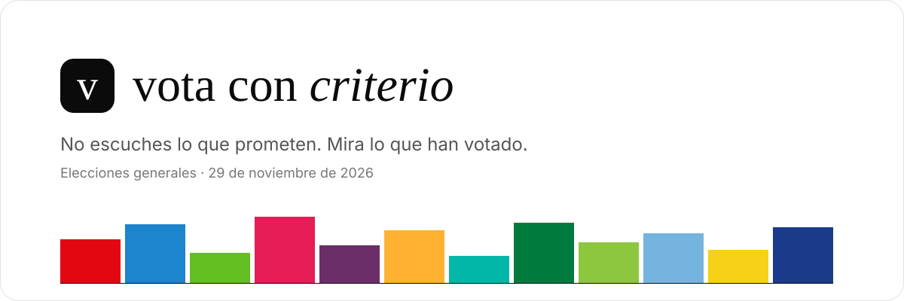
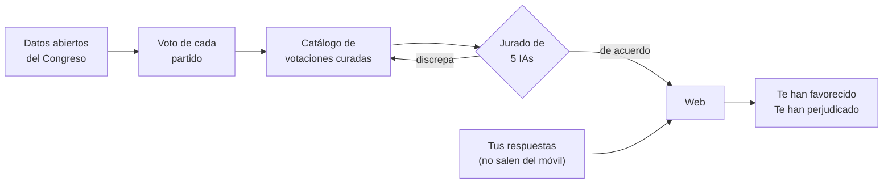

<p align="center">
  
</p>

<p align="center">
  <strong>¿A quién te convendría votar según lo que cada partido ha votado de verdad en el Congreso?</strong>
</p>

<p align="center">
  
  
  
  <a href="./LICENSE"></a>
</p>

<p align="center">
  <a href="#cómo-funciona">Cómo funciona</a> ·
  <a href="#neutralidad">Neutralidad</a> ·
  <a href="#estado">Estado</a> ·
  <a href="#desarrollo">Desarrollo</a> ·
  <a href="#contribuir">Contribuir</a>
</p>

---

Vota con Criterio es una web anónima para las **elecciones generales del 29 de noviembre de 2026**.
Respondes unas preguntas sobre tu situación —provincia, vivienda, trabajo, ingresos, familia— y la
web las cruza con una selección de votaciones del Congreso de las dos últimas legislaturas que
afectan a personas como tú.

El resultado son dos podios: **los partidos que más te han favorecido** y **los que más te han
perjudicado**, con cada votación enlazada a su fuente oficial.

Se publicará en **`vota.concriterio.blog`**, un proyecto de [Con Criterio](https://concriterio.blog)
firmado por Pol Marzà.

> **Hechos, no promesas.** Los programas electorales se incumplen y los tests de afinidad comparan
> tus opiniones con lo que *dicen* los partidos. Este compara tu situación con lo que *hicieron*.

---

## Cómo funciona



1. **Votos reales.** Se descargan las votaciones nominales de las legislaturas XIV (2019–2023) y
   XV (2023–2026): el voto de cada diputado. El voto de un partido es el de la mayoría de sus
   diputados presentes, y si se dividió, se dice.
2. **Votaciones que importan.** De miles de votaciones se eligen las que afectan de forma clara a
   situaciones concretas (alquiler, autónomos, familias, dependencia, tu comunidad…). Cada una dice
   qué significaba votar "Sí", a quién afecta y por qué.
3. **Tu perfil.** Un bloque básico de preguntas da un resultado provisional que ya puedes
   compartir; un bloque ampliado lo afina.
4. **Tu resultado.** Para cada partido que se presenta en tu provincia, el porcentaje de votaciones
   en las que votó a tu favor y en tu contra. Debajo, todas las votaciones que lo explican.

---

## Neutralidad

| | |
|---|---|
| **Solo hechos** | Nada de programas ni declaraciones: lo que cada partido votó, sacado de los datos oficiales y nunca escrito a mano. |
| **Trazable** | Cada votación enlaza a congreso.es y explica su etiqueta. |
| **Jurado de IAs** | Claude selecciona y etiqueta; cinco modelos de cinco empresas (OpenAI, Google, Mistral, DeepSeek y xAI) revisan cada etiqueta. Si la mayoría discrepa, no se publica. |
| **Sin colores de nadie** | La interfaz es blanco y negro: el color solo aparece para identificar a cada partido. |
| **Abierto** | El catálogo, los veredictos del jurado y el cálculo están en este repositorio. |
| **Anónimo** | Las respuestas se procesan en tu navegador. Sin registro, sin cookies de seguimiento, sin servidor que las reciba. |

---

## Estado

**En desarrollo.** Objetivo: en producción antes del 20 de noviembre de 2026, en plena campaña.

- [x] Producto, diseño, arquitectura y modelo de datos definidos (`docs/`)
- [ ] Ingesta de datos del Congreso — *en construcción* ([ficha](docs/features/ingesta-congreso.md))
- [ ] Catálogo de votaciones curadas
- [ ] Jurado de IAs
- [ ] Web: portada, cuestionario y resultado
- [ ] Imagen para compartir

---

## Desarrollo

**Requisitos:** Node.js 24 (LTS) y pnpm v11 (no npm ni yarn).

```bash
pnpm install
pnpm test             # tests unitarios y validación de datos
```

**Pipeline de datos** (en local):

```bash
pnpm data:ingesta     # descarga las votaciones y los diputados del Congreso a data/raw/
pnpm data:partidos    # valida la herencia de partidos y asigna cada diputado
```

Próximamente: `pnpm data:votos`, `pnpm data:jurado`, `pnpm dev` y `pnpm build`.

La única variable de entorno es `OPENROUTER_API_KEY`, solo para el jurado de IAs. Copia
`.env.example` a `.env.local` y nunca lo comitees.

<details>
<summary><strong>Estructura del repositorio</strong></summary>

```
data/        → Votaciones del Congreso, partidos, candidaturas, preguntas, catálogo y jurado
docs/        → Producto, diseño, arquitectura, modelo de datos y testing
scripts/     → Pipeline de datos y verificación de cobertura de las fichas
src/         → Web en Astro (próximamente)
tests/       → Vitest y Playwright
changelog/   → Registro de cada cambio importante
mejoras/     → Ideas para más adelante
```

El detalle está en [`docs/architecture.md`](./docs/architecture.md) y el formato de cada archivo
de datos en [`docs/data-model.md`](./docs/data-model.md).

</details>

---

## Contribuir

¿Crees que una votación está mal etiquetada, que falta una importante o que un diputado está
asignado al partido equivocado? **Abre un issue** con el enlace a la votación o a la ficha del
diputado en congreso.es y tu argumento.

El proyecto se trabaja con agentes de código siguiendo el protocolo de [`AGENTS.md`](./AGENTS.md):
cada feature empieza por una ficha en `docs/features/`, cada cambio importante deja entrada en
`changelog/` y cada PR lleva la salida real de los tests.

---

<p align="center">
  MIT © 2026 Pol Marzà · Un proyecto de <a href="https://concriterio.blog">Con Criterio</a>
</p>
