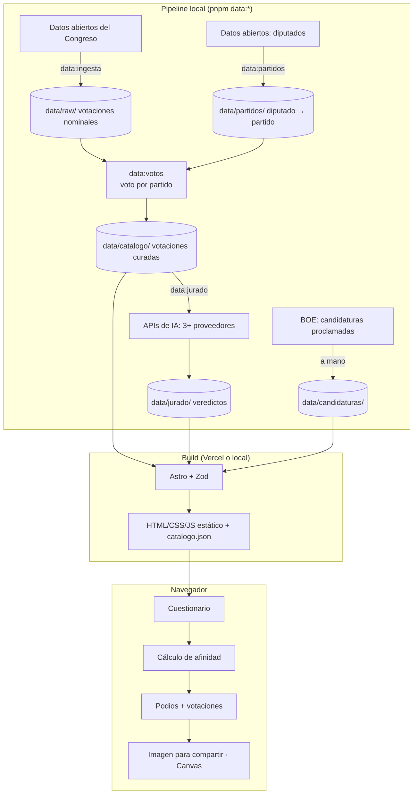

# Arquitectura técnica

<!-- Documento vivo. Actualizar cada vez que cambie el stack, la estructura de carpetas
     o cualquier decisión técnica relevante.
     Los cambios deben registrarse también en changelog/. -->

Vota con Criterio tiene dos mitades que no se tocan en producción:

1. **Pipeline de datos (local, en la máquina de Pol o del agente):** descarga las votaciones del
   Congreso, calcula el voto de cada partido, valida el catálogo curado y pasa el jurado de IAs.
   Produce archivos versionados en `data/`.
2. **Web estática (Vercel):** Astro lee `data/` en tiempo de build y genera HTML. El cuestionario
   y el cálculo corren en el navegador. No hay servidor, base de datos ni API en producción.

---

## Stack seleccionado

| Capa | Tecnología | Justificación |
|------|-----------|---------------|
| Framework | Astro 5 (salida `static`) + TypeScript estricto | Web de contenido con una sola parte interactiva; HTML estático rápido y sin JS innecesario. Elegido por Pol. |
| Interactividad | TypeScript sin framework de UI (script de cliente de Astro) | El cuestionario y el resultado son pocos estados; un framework añadiría peso sin aportar. |
| Datos | Archivos YAML/JSON en `data/` + Content Collections de Astro con esquemas Zod | El catálogo vive en el repo, es revisable en cada PR y el build falla si una votación no cumple el esquema (M-05). |
| Base de datos | Ninguna | Nada que persistir: no hay cuentas ni respuestas guardadas (M-08). |
| Autenticación | Ninguna | Web anónima. |
| Estilos | CSS propio con custom properties (tokens de `design-system.md`), estilos con ámbito de Astro | Paleta en blanco y negro con pocos componentes; no compensa Tailwind. |
| Tipografía | Instrument Serif e Inter vía `@fontsource`, autoalojadas | Sin peticiones a Google: coherente con la privacidad y más rápido. |
| Iconos | Tabler Icons (SVG inline, solo los usados) | Coincide con las maquetas. |
| Imagen para compartir | Canvas API del navegador | La imagen se genera en el dispositivo; el resultado nunca sale del navegador (S-02, M-08). |
| Pipeline | Scripts Node 24 (LTS) + TypeScript ejecutados con `pnpm` (`tsx`) | Mismo lenguaje que la web; los tipos del catálogo se comparten. |
| Jurado de IAs | SDKs oficiales de cada proveedor, solo en local | Ver "Integraciones externas". |
| Tests | Vitest (lógica y datos) + Playwright (e2e contra `localhost`) | Ver `testing.md`. |
| Despliegue | Vercel (integración con GitHub) | Elegido por Pol. Previews por rama, CDN, cero configuración para Astro estático. |
| DNS | Hostinger: `vota.concriterio.blog` → CNAME a Vercel | Lo configura Pol. |

---

## Diagrama de componentes



Las respuestas del cuestionario solo existen en memoria del navegador: no van a la URL, ni a
`localStorage`, ni a ningún servidor.

---

## Estructura de carpetas

```
data/
├── raw/                → Votaciones nominales descargadas del Congreso, tal cual (XIV y XV)
├── partidos/           → Colores, logos y correspondencia diputado → partido por legislatura
├── candidaturas/       → Partidos que se presentan en cada provincia (BOE, 29-N-2026)
├── catalogo/           → Una ficha YAML por votación curada: resumen, perfiles, etiquetas, justificación
└── jurado/             → Veredicto de cada modelo por votación, con fecha, modelo y prompt
scripts/
├── data/               → Pipeline: ingesta, partidos, votos, jurado, validación
└── verificar-cobertura.mjs → Comprueba las fichas de docs/features/
src/
├── pages/              → index (portada), test, como-funciona, votaciones
├── components/         → Componentes Astro (Cabecera, Ecualizador, Pregunta, FilaPartido…)
├── lib/
│   ├── afinidad/       → Cálculo puro de la puntuación (sin DOM; lo prueban los tests)
│   ├── perfil/         → Definición de preguntas y conversión de respuestas a perfiles
│   └── compartir/      → Generación de la imagen con Canvas
├── content.config.ts   → Colecciones y esquemas Zod del catálogo
└── styles/             → Tokens y estilos globales
public/
├── logos/              → Logos de los partidos (SVG)
└── fonts/              → Solo si @fontsource no cubre algo
tests/
├── unit/               → Vitest
└── e2e/                → Playwright
```

---

## Estrategia de autenticación

No hay autenticación: la web es anónima y no tiene cuentas ni zonas privadas. Las únicas
credenciales del proyecto son las claves de las APIs de IA del jurado, que solo se usan en local
(ver abajo) y nunca llegan a Vercel ni al navegador.

---

## Integraciones externas

- **Datos abiertos del Congreso** (`congreso.es/es/opendata/votaciones` y `/diputados`): fuente
  de las votaciones nominales y de la filiación de cada diputado. Se descargan con
  `pnpm data:ingesta` y se guardan en `data/raw/` para no depender de la web del Congreso en el
  build. **Riesgo por verificar antes que nada:** el 26-10-2026 el ZIP de la última sesión
  (XV, sesión 203) solo contenía gráficos PNG, sin JSON ni XML. Hay que confirmar en qué formato
  están las votaciones nominales de la XIV y la XV; si no hay formato estructurado para alguna
  sesión, la alternativa es extraerlas del Diario de Sesiones (PDF), con más coste.
- **Correspondencia diputado → partido:** el Congreso registra el grupo parlamentario, no el
  partido. La correspondencia sale de la formación por la que se presentó cada diputado
  (datos abiertos de diputados) y se guarda en `data/partidos/`, con las excepciones (cambios de
  partido, bajas) documentadas a mano.
- **BOE — candidaturas proclamadas:** se publican unas cuatro semanas antes de las elecciones. Con
  ellas se rellena `data/candidaturas/` a mano (qué partidos con historial se presentan en cada
  provincia). Hasta su publicación se trabaja con una lista provisional marcada como tal.
- **Jurado de IAs vía OpenRouter** (M-10): `pnpm data:jurado` se lanza en local desde la
  terminal. Envía cada votación curada a cinco modelos de cinco empresas distintas a través de la
  API de OpenRouter (compatible con la de OpenAI), con el mismo prompt y respuesta en JSON
  estructurado (`structured_outputs`). Guarda en `data/jurado/` el veredicto (de acuerdo / en
  desacuerdo, y por qué), el identificador exacto del modelo, el prompt y la fecha. Una sola
  clave, `OPENROUTER_API_KEY`, en `.env.local`. Jurado fijado el 26-10-2026 a partir del listado
  de `openrouter.ai/api/v1/models`:

  | Empresa | Modelo en OpenRouter | Por qué este |
  |---------|----------------------|--------------|
  | OpenAI (EE. UU.) | `openai/gpt-6.1-sol` | Modelo alto de la serie 6.1; el tope (`gpt-6-astra`) cuesta 5 veces más sin aportar a esta tarea |
  | Google (EE. UU.) | `google/gemini-4-argon` | Modelo insignia de razonamiento de Google |
  | Mistral (Francia) | `mistralai/mistral-large-4-0` | Insignia de Mistral; única empresa europea |
  | DeepSeek (China) | `deepseek/deepseek-v4-pro-0813` | Versión estable (GA) de su modelo grande |
  | xAI (EE. UU.) | `x-ai/grok-4.7` | Insignia actual de xAI |

  Cinco jueces (número impar, sin empates). Claude no forma parte del jurado porque es quien
  selecciona y etiqueta. Si la mayoría (3 de 5) discrepa de una etiqueta, la votación no se
  publica hasta corregirla o descartarla. Si un modelo deja de estar disponible, se sustituye por
  otro de la misma empresa y se anota aquí. Coste estimado: unos pocos dólares para todo el
  catálogo.
- **Vercel:** alojamiento estático y previews por rama. Sin funciones ni variables de entorno en
  producción.
- **Vercel Web Analytics:** cuenta visitas y cuántas personas llegan al resultado provisional y al
  final, sin cookies. Los resultados se marcan como rutas virtuales (`/test/provisional`,
  `/test/resultado`, mediante `history.pushState`) para que cuenten como páginas vistas; esas
  rutas no llevan ninguna respuesta. No se envían eventos con datos del cuestionario.

---

## MCPs del proyecto

| Servidor | Alcance | Para qué se usa | Variables necesarias |
|----------|---------|-----------------|----------------------|
| vercel | conector de claude.ai (ya configurado por Pol, fuera del repo) | Consultar despliegues, logs de build y dominios sin salir del editor | — (OAuth) |

No hace falta ningún otro: no hay base de datos, pagos ni email.

---

## Estrategia de despliegue

- **Ramas:** `main` es producción. Cada cambio va en una rama con PR; Vercel genera una preview
  por PR.
- **Entornos:** local (`pnpm dev`, `http://localhost:4321`) y producción. No hay staging: las
  previews de Vercel cumplen esa función para revisar a ojo, pero los tests se ejecutan siempre en
  local.
- **Antes de mergear:** `pnpm test`, `pnpm test:e2e` y `pnpm build` en local, con la salida pegada
  en el PR.
- **Quién despliega:** Pol. Mergear a `main` despliega en producción a través de la integración
  de Vercel con GitHub. El agente prepara el PR, pero no mergea ni lanza despliegues.
- **Dominio:** Pol añade `vota.concriterio.blog` en el proyecto de Vercel y crea en Hostinger el
  CNAME `vota` que indique Vercel.
- **Calendario:** en producción antes del 13 de noviembre de 2026 (inicio de campaña). Hasta el
  29 de noviembre solo se despliegan correcciones.

---

## Decisiones técnicas relevantes

### 2026-10-26 — Todo el cálculo en el navegador
**Contexto:** el cuestionario recoge datos personales sensibles (ingresos, discapacidad, hijos).
**Opciones consideradas:** calcular en una función de servidor; calcular en el cliente.
**Decisión:** cliente. El catálogo completo (unas decenas de votaciones) pesa pocos KB y se
entrega como JSON estático.
**Consecuencias:** cero datos personales en servidores; el catálogo es público (lo cual es
deseable por transparencia). Se mide cuánta gente entra y termina, pero no qué responde, y es
intencionado.

### 2026-10-26 — Código abierto
**Decisión:** el repositorio se hace público en GitHub al terminar la inicialización, con
licencia MIT.
**Consecuencias:** cualquiera puede revisar el catálogo, las etiquetas, los veredictos del jurado
y el cálculo.

### 2026-10-26 — Votos por partido a partir del voto nominal
**Contexto:** los grupos parlamentarios mezclan partidos (Mixto, Sumar, Unidas Podemos).
**Decisión:** el voto de cada partido es el de la mayoría de sus diputados presentes; si hay
división, se marca y se muestra el desglose (M-06).
**Consecuencias:** hace falta mantener la correspondencia diputado → partido por legislatura.

### 2026-10-26 — Catálogo en el repositorio, no en un CMS
**Decisión:** fichas YAML en `data/catalogo/`, validadas con Zod en el build.
**Consecuencias:** cada cambio en una etiqueta queda en el historial de git, con su PR; es la
mejor prueba de neutralidad que se puede ofrecer.
