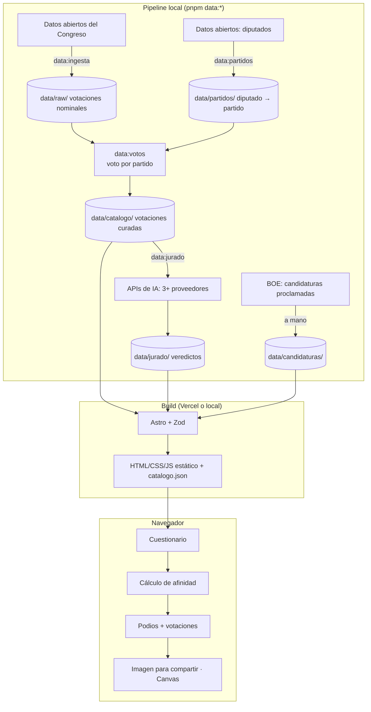

# Arquitectura técnica

<!-- Documento vivo. Actualizar cada vez que cambie el stack, la estructura de carpetas
     o cualquier decisión técnica relevante.
     Los cambios deben registrarse también en changelog/. -->

Vota con Criterio tiene dos mitades que no se tocan en producción:

1. **Pipeline de datos (local, en la máquina de Pol o del agente):** descarga las votaciones del
   Congreso, calcula el voto de cada partido, valida el catálogo curado y pasa el jurado de IAs.
   Produce archivos versionados en `data/`.
2. **Web estática (Vercel):** Astro lee `data/` en tiempo de build y genera HTML. El cuestionario
   y el cálculo corren en el navegador. No hay servidor, base de datos ni API en producción.

---

## Stack seleccionado

| Capa | Tecnología | Justificación |
|------|-----------|---------------|
| Framework | Astro 7 (salida `static`) + TypeScript estricto | Web de contenido con una sola parte interactiva; HTML estático rápido y sin JS innecesario. Elegido por Pol. |
| Interactividad | TypeScript sin framework de UI (script de cliente de Astro) | El cuestionario y el resultado son pocos estados; un framework añadiría peso sin aportar. |
| Datos | Archivos YAML/JSON en `data/` + Content Collections de Astro con esquemas Zod | El catálogo vive en el repo, es revisable en cada PR y el build falla si una votación no cumple el esquema (M-05). |
| Base de datos | Ninguna | Nada que persistir: no hay cuentas ni respuestas guardadas (M-08). |
| Autenticación | Ninguna | Web anónima. |
| Estilos | CSS propio con custom properties (tokens de `design-system.md`) sobre el kit de Taste Skill copiado en `src/kit/` (`system.css`, `layout.css`, `motion.css`; ningún momento), estilos con ámbito de Astro | Es el sistema de la propuesta Ventana elegida por Pol; copiarlo tal cual mantiene la web fiel a la maqueta. No compensa Tailwind. |
| Tipografía | Geist y Geist Mono vía `@fontsource-variable`, autoalojadas | Sin peticiones a Google: coherente con la privacidad y más rápido. |
| Iconos | Tabler Icons (SVG inline, solo los usados) | Coincide con las maquetas. |
| Imagen para compartir | Canvas API del navegador | La imagen se genera en el dispositivo; el resultado nunca sale del navegador (S-02, M-08). |
| Pipeline | Scripts Node 24 (LTS) + TypeScript ejecutados con `pnpm` (`tsx`) | Mismo lenguaje que la web; los tipos del catálogo se comparten. |
| Jurado de IAs | SDKs oficiales de cada proveedor, solo en local | Ver "Integraciones externas". |
| Tests | Vitest (lógica y datos) + Playwright (e2e contra `localhost`) | Ver `testing.md`. |
| Despliegue | Vercel (integración con GitHub) | Elegido por Pol. Previews por rama, CDN, cero configuración para Astro estático. |
| DNS | Hostinger: `vota.concriterio.blog` → CNAME a Vercel | Lo configura Pol. |

---

## Diagrama de componentes



Las respuestas del cuestionario solo existen en memoria del navegador: no van a la URL, ni a
`localStorage`, ni a ningún servidor.

El cuestionario es un componente (`src/components/Cuestionario.astro`: el marcado y los datos que
necesita el navegador) con su comportamiento en `src/scripts/cuestionario.ts`, y lo montan dos
páginas: `/test` y la portada. En la portada está oculto: la ventana del héroe tiene el selector de
provincia de verdad y, al pulsar "Siguiente", la portada se oculta, el cuestionario aparece en la
segunda pregunta y la dirección pasa a `/test` con `history.pushState(null, '', '/test')`, sin
ninguna respuesta. "Atrás" en la primera pregunta y el botón atrás del navegador (`popstate`)
vuelven a la portada en el mismo documento; adelante vuelve al paso en el que se quedó; recargar en
`/test` carga la página `/test` normal y las respuestas se pierden. Así la provincia no tiene que
pasar de una página a otra (ni por la URL ni por el almacenamiento). El precio es el peso: la
portada lleva los datos del cuestionario en su HTML (ver "Decisiones técnicas", 2026-11-11).

---

## Estructura de carpetas

```
data/
├── raw/                → Votaciones nominales descargadas del Congreso, tal cual (XIV y XV)
├── partidos/           → Colores, logos y correspondencia diputado → partido por legislatura
├── candidaturas/       → Partidos que se presentan en cada provincia (BOE, 29-N-2026)
├── catalogo/           → Una ficha YAML por votación curada: resumen, perfiles, etiquetas, justificación
└── jurado/             → Veredicto de cada modelo por votación, con fecha, modelo y prompt
scripts/
├── data/               → Pipeline: ingesta, partidos, votos, jurado, validación
└── verificar-cobertura.mjs → Comprueba las fichas de docs/features/
src/
├── pages/              → index (portada), test, como-funciona, votaciones
├── components/         → Componentes Astro (Cabecera, Pie, Cuestionario, Pregunta,
│                         SelectorProvincia, PreguntasFrecuentes)
├── kit/                → Kit de Taste Skill de la propuesta Ventana (CSS y JS del menú, la barra del
│                         móvil, la entrada del héroe y el cargador de momentos, hoy sin ninguno),
│                         copiado de propuestas-diseno/
├── lib/
│   ├── afinidad/       → Cálculo puro de la puntuación (sin DOM; lo prueban los tests)
│   ├── perfil/         → Definición de preguntas y conversión de respuestas a perfiles
│   ├── enlaces.ts      → Enlaces que se repiten (el repositorio)
│   ├── explorador.ts   → Prepara en el build las votaciones de /votaciones (voto, efectos, jurado)
│   └── compartir/      → Generación de la imagen con Canvas
├── content.config.ts   → Colecciones y esquemas Zod del catálogo
├── scripts/            → cuestionario.ts: el cuestionario en el navegador (lo montan /test y la
│                         portada); selector-provincia.ts: el autocompletado de provincia;
│                         resultado.ts: pinta el resultado; explorador.ts: filtros y "Ver más" de
│                         /votaciones
└── styles/             → Paleta, fuentes y componentes de la web sobre el kit
public/
├── logos/              → Logos de los partidos (SVG)
└── fonts/              → Solo si @fontsource no cubre algo
tests/
├── unit/               → Vitest
└── e2e/                → Playwright
```

---

## Estrategia de autenticación

No hay autenticación: la web es anónima y no tiene cuentas ni zonas privadas. Las únicas
credenciales del proyecto son las claves de las APIs de IA del jurado, que solo se usan en local
(ver abajo) y nunca llegan a Vercel ni al navegador.

---

## Integraciones externas

- **Datos abiertos del Congreso** (`congreso.es/es/opendata/votaciones` y `/diputados`): fuente
  de las votaciones nominales y de la filiación de cada diputado. Se descargan con
  `pnpm data:ingesta` y se guardan en `data/raw/` para no depender de la web del Congreso en el
  build. **Formato verificado el 26-10-2026:** hay un JSON por votación con el voto nominal de
  cada diputado en la XIV y en la XV (comprobado en sesiones de 2021, 2024 y hasta junio de 2026).
  Las sesiones más recientes (al menos la del 2-10-2026) solo publican el gráfico PNG, sin JSON.
  Detalle en `docs/features/ingesta-congreso.md`.
- **Correspondencia diputado → partido:** el Congreso registra el grupo parlamentario, no el
  partido. La correspondencia sale de la formación por la que se presentó cada diputado
  (datos abiertos de diputados) y se guarda en `data/partidos/`, con las excepciones (cambios de
  partido, bajas) documentadas a mano.
- **BOE — candidaturas proclamadas:** se publican unas cuatro semanas antes de las elecciones. Con
  ellas se rellena `data/candidaturas/` a mano (qué partidos con historial se presentan en cada
  provincia). Hasta su publicación se trabaja con una lista provisional marcada como tal.
- **Jurado de IAs vía OpenRouter** (M-10): `pnpm data:jurado` se lanza en local desde la
  terminal. Envía cada votación curada a cinco modelos de cinco empresas distintas a través de la
  API de OpenRouter (compatible con la de OpenAI), con el mismo prompt y respuesta en JSON
  estructurado (`structured_outputs`). Guarda en `data/jurado/` el veredicto (de acuerdo / en
  desacuerdo, y por qué), el identificador exacto del modelo, el prompt y la fecha. Una sola
  clave, `OPENROUTER_API_KEY`, en `.env.local`. Jurado fijado el 26-10-2026 a partir del listado
  de `openrouter.ai/api/v1/models`:

  | Empresa | Modelo en OpenRouter | Por qué este |
  |---------|----------------------|--------------|
  | OpenAI (EE. UU.) | `openai/gpt-6.1-sol` | Modelo alto de la serie 6.1; el tope (`gpt-6-astra`) cuesta 5 veces más sin aportar a esta tarea |
  | Google (EE. UU.) | `google/gemini-4-argon` | Modelo insignia de razonamiento de Google |
  | Mistral (Francia) | `mistralai/mistral-large-4-0` | Insignia de Mistral; única empresa europea |
  | DeepSeek (China) | `deepseek/deepseek-v4-pro-0813` | Versión estable (GA) de su modelo grande |
  | xAI (EE. UU.) | `x-ai/grok-4.7` | Insignia actual de xAI |

  Cinco jueces (número impar, sin empates). Claude no forma parte del jurado porque es quien
  selecciona y etiqueta. Si la mayoría (3 de 5) discrepa de una etiqueta, la votación no se
  publica hasta corregirla o descartarla. Si un modelo deja de estar disponible, se sustituye por
  otro de la misma empresa y se anota aquí. Coste estimado: unos pocos dólares para todo el
  catálogo.
- **Vercel:** alojamiento estático y previews por rama. Sin funciones ni variables de entorno en
  producción.
- **Vercel Web Analytics:** cuenta visitas y cuántas personas llegan al resultado provisional y al
  final, sin cookies. Los resultados se marcan como rutas virtuales (`/test/provisional`,
  `/test/resultado`, mediante `history.pushState`) para que cuenten como páginas vistas; esas
  rutas no llevan ninguna respuesta. No se envían eventos con datos del cuestionario.

---

## MCPs del proyecto

| Servidor | Alcance | Para qué se usa | Variables necesarias |
|----------|---------|-----------------|----------------------|
| vercel | conector de claude.ai (ya configurado por Pol, fuera del repo) | Consultar despliegues, logs de build y dominios sin salir del editor | — (OAuth) |

No hace falta ningún otro: no hay base de datos, pagos ni email.

---

## Estrategia de despliegue

- **Ramas:** `main` es producción. Cada cambio va en una rama con PR; Vercel genera una preview
  por PR.
- **Entornos:** local (`pnpm dev`, `http://localhost:4321`) y producción. No hay staging: las
  previews de Vercel cumplen esa función para revisar a ojo, pero los tests se ejecutan siempre en
  local.
- **Antes de mergear:** `pnpm test`, `pnpm test:e2e` y `pnpm build` en local, con la salida pegada
  en el PR.
- **Quién despliega:** Pol. Mergear a `main` despliega en producción a través de la integración
  de Vercel con GitHub. El agente prepara el PR, pero no mergea ni lanza despliegues.
- **Dominio:** Pol añade `vota.concriterio.blog` en el proyecto de Vercel y crea en Hostinger el
  CNAME `vota` que indique Vercel.
- **Calendario:** en producción antes del 20 de noviembre de 2026 (retrasado el 11-11 desde el 13,
  inicio de campaña). Hasta el
  29 de noviembre solo se despliegan correcciones.

---

## Decisiones técnicas relevantes

### 2026-10-26 — Todo el cálculo en el navegador
**Contexto:** el cuestionario recoge datos personales sensibles (ingresos, discapacidad, hijos).
**Opciones consideradas:** calcular en una función de servidor; calcular en el cliente.
**Decisión:** cliente. El catálogo completo (unas decenas de votaciones) pesa pocos KB y se
entrega como JSON estático.
**Consecuencias:** cero datos personales en servidores; el catálogo es público (lo cual es
deseable por transparencia). Se mide cuánta gente entra y termina, pero no qué responde, y es
intencionado.

### 2026-10-26 — Código abierto
**Decisión:** el repositorio se hace público en GitHub al terminar la inicialización, con
licencia MIT.
**Consecuencias:** cualquiera puede revisar el catálogo, las etiquetas, los veredictos del jurado
y el cálculo.

### 2026-10-26 — Votos por partido a partir del voto nominal
**Contexto:** los grupos parlamentarios mezclan partidos (Mixto, Sumar, Unidas Podemos).
**Decisión:** el voto de cada partido es el de la mayoría de sus diputados presentes; si hay
división, se marca y se muestra el desglose (M-06).
**Consecuencias:** hace falta mantener la correspondencia diputado → partido por legislatura.

### 2026-10-26 — Catálogo en el repositorio, no en un CMS
**Decisión:** fichas YAML en `data/catalogo/`, validadas con Zod en el build.
**Consecuencias:** cada cambio en una etiqueta queda en el historial de git, con su PR; es la
mejor prueba de neutralidad que se puede ofrecer.

### 2026-11-11 — El test empieza en la portada, en el mismo documento
**Contexto:** Pol quiere que la ventana del héroe sea la primera pregunta de verdad y que el test
siga sin cambiar de página. Pasar la provincia a `/test` obligaría a guardarla en la URL o en el
almacenamiento, y M-08 lo prohíbe.
**Decisión:** la portada incluye el cuestionario oculto (`Cuestionario.astro`) y el paso al test es
cambiar qué se ve, más `history.pushState` a `/test` sin respuestas; `popstate` vuelve a la
portada. El comportamiento del cuestionario y del selector de provincia se sacó a
`src/scripts/cuestionario.ts` y `src/scripts/selector-provincia.ts` para montarlos en las dos
páginas.
**Coste:** con el catálogo del 11-11 (76 fichas), la portada pasa de 55,3 kB (8,8 kB con gzip) a
296,7 kB (31,7 kB con gzip): casi todo es el JSON de datos del cuestionario (195 kB; 18,7 kB con
gzip, sobre todo fichas y votos), que crece con el catálogo. Carga además el script
del cuestionario (19,5 kB; 7,9 kB con gzip), que comparte con `/test` y queda en caché. No hay datos
que se repitan: el resultado de ejemplo se pinta en el build y no lleva ese JSON.
**Si pesa demasiado:** mover el JSON de datos a un archivo estático con hash (lo comparten `/` y
`/test` y se cachea) cargado al cargar la página, antes de cualquier respuesta; o pintar el
resultado de ejemplo en el navegador con ese mismo JSON en lugar de llevar los nueve perfiles en
HTML. Ninguna de las dos se ha hecho.
