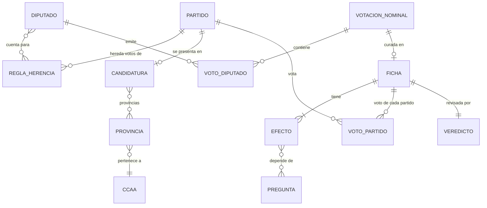

# Modelo de datos

<!-- Actualizar este archivo cada vez que se añada, modifique o elimine una entidad o relación.
     El agente de codificación debe consultar este archivo antes de tocar data/ o los esquemas. -->

No hay base de datos. Todos los datos son **archivos versionados en `data/`**, generados por el
pipeline local o escritos a mano, y validados con esquemas Zod (`src/content.config.ts` y
`scripts/data/esquemas.ts`) en cada build. Si un archivo no cumple su esquema, el build falla.

Hay tres tipos de datos:

- **Brutos** (`data/raw/`): copia literal de los datos abiertos del Congreso. Nunca se editan.
- **Derivados** (generados por scripts): voto por partido. Nunca se editan a mano.
- **Curados** (escritos por Claude y revisados por el jurado): partidos, candidaturas, preguntas,
  fichas del catálogo. Cada cambio pasa por un PR.

---

## Entidades principales

### Provincia — `data/territorio.yaml` (curado, estable)
| Campo | Tipo | Descripción |
|-------|------|-------------|
| id | slug | `valencia`, `a-coruna`… (52) |
| nombre | texto | Nombre oficial |
| ccaa | slug | Comunidad o ciudad autónoma a la que pertenece (19) |

### Partidos — `data/partidos/partidos.yaml` (curado)
Las candidaturas que pueden aparecer en el resultado, a nivel de partido individual (Podemos, IU,
Compromís…), no de coalición. Lo valida `pnpm data:partidos` (`scripts/data/partidos.ts`).

| Campo | Tipo | Descripción |
|-------|------|-------------|
| alias | { XIV: {...}, XV: {...} } | Nombre en las votaciones → nombre en la ficha del diputado, cuando no coinciden (p. ej. "Cuesta Rodríguez, María del Socorro" → "Cuesta Rodríguez, María") |
| coaliciones | { XIV: [...], XV: [...] } | Formaciones electorales que eran coaliciones (`UP`, `SUMAR`…): sus diputados se asignan uno a uno por nombre |
| sinPartido | lista de { legislatura, formacion, motivo } | Formaciones cuyos votos no cuentan para nadie (p. ej. PDeCAT, disuelto) |
| diputadosSinPartido | lista de { legislatura, diputado, motivo, fuente? } | Diputados de coalición cuyo partido no concurre (p. ej. Equo, Foro) |
| partidos | lista de Partido | |

**Partido**
| Campo | Tipo | Descripción |
|-------|------|-------------|
| id | slug | `psoe`, `pp`, `podemos`… |
| nombre, siglas | texto | |
| color | hex (opcional hasta la feature de la web) | Color oficial; único entre partidos (design-system) |
| posicion_ideologica | { valor: 0–10, fuente: texto, junto_a?: id } (opcional) | Orden de izquierda a derecha en `/votaciones` (S-01): `lrgen` de la Chapel Hill Expert Survey 2024, con dos decimales, o de la CHES 2019 si no está en la de 2024 (Cs). Un partido que no está en ninguna lleva `junto_a` (el partido de su grupo parlamentario que sí está o, si votaba desde el Mixto, el de la CHES con el que más coincidió su voto) y el mismo `valor`; se coloca justo después de él. No interviene en el cálculo |
| herencia | { XIV?: [Regla], XV?: [Regla] } | Qué votos de cada legislatura cuentan como de este partido |

**Regla de herencia**
| Campo | Tipo | Descripción |
|-------|------|-------------|
| formaciones | lista de texto | `FORMACIONELECTORAL` del Congreso cuyos diputados cuentan |
| diputados | lista de nombres | Diputados concretos, para los elegidos en coalición; tienen prioridad sobre las reglas por formación |
| grupos | lista de códigos (opcional) | Solo los votos emitidos desde esos grupos (`GS`, `GSUMAR`, `GMx`…). Así, por ejemplo, los votos de Ábalos dejan de contar para el PSOE al pasar al Mixto |
| desde / hasta | AAAA-MM-DD (opcional) | Si la regla solo vale para un periodo |
| justificacion | texto | Obligatorio; se publicará en "Cómo funciona" |
| fuente | URL (opcional) | De dónde sale la asignación |
| dudas | texto (opcional) | Lo que no está claro; el jurado lo revisa con especial atención |

**Regla general: cada voto cuenta para el partido al que pertenecía el diputado cuando votó.** Por
eso un mismo diputado puede contar para partidos distintos en cada legislatura (Yolanda Díaz: IU en
la XIV, Sumar en la XV) o dejar de contar a mitad (Ábalos al salir del PSOE). Se aplica a todos sin excepción: los votos de un
partido que no concurre el 29-N (Más País, Equo, Foro, PDeCAT) no se atribuyen a otro parecido, y los
de un independiente elegido en una lista no cuentan para el partido de esa lista.

Un voto que encaje en reglas de dos partidos es un error. Un diputado de coalición sin asignar no
cuenta para nadie hasta que se asigne; `pnpm data:partidos` los lista.

### Candidatura — `data/candidaturas/2026.yaml` (curado, a partir del BOE)
| Campo | Tipo | Descripción |
|-------|------|-------------|
| partido | id de Partido | |
| provincias | lista de ids de Provincia, o `todas` | Dónde se presenta |
| listas | lista de texto | Listas del BOE en las que va (sola o en coalición: "Frente Amplio (FA)") |
| fuente | URL | Publicación del BOE (a nivel de archivo) |
| provisional | booleano | `true` hasta que se publiquen las candidaturas proclamadas (a nivel de archivo) |

Un partido que concurre en coalición aparece como partido individual en cada provincia donde se
presenta la coalición (Movimiento Sumar e IU en Frente Amplio, Ciudadanos en D21, UPN con el PP).

Un partido sin candidatura en la provincia del visitante no aparece (M-02). Un partido sin
herencia en ninguna legislatura no puede tener candidatura (partido nuevo).

### Diputado con partido — `data/partidos/diputados-<leg>.json` (derivado por `pnpm data:partidos`)
| Campo | Tipo | Descripción |
|-------|------|-------------|
| nombre, formacion, circunscripcion | texto | Del Congreso |
| partido | id de Partido, varios separados por comas, `pendiente`, `sin-partido` o `null` | Partido según las reglas por nombre o formación, sin aplicar grupo ni fechas (eso se aplica voto a voto) |

### Día de votaciones — `data/raw/<leg>/dias/<AAAAMMDD>.json` (bruto, compactado)
Todas las votaciones de un día, sin editar pero en formato compacto (`scripts/data/congreso.ts`).
| Campo | Tipo | Descripción |
|-------|------|-------------|
| legislatura, fecha | | |
| diputados | lista de texto | Nombres ("Apellidos, Nombre") que votaron ese día, ordenados |
| codigosGrupo | lista de texto | Grupos parlamentarios del día (`GS`, `GP`, `GSUMAR`…; puede haber `""`) |
| votaciones | lista | Por votación: sesion, numero, fecha, titulo, expediente, subgrupo, textoSubgrupo, conjuntas, asentimiento, secreta, totales oficiales y dos cadenas alineadas con `diputados`: `votos` (S sí, N no, A abstención, X no vota, espacio si no aparece) y `grupos` (letra "a" = primer código de grupo…) |
| sinJson | lista de rutas | Votaciones que el Congreso publica solo como gráfico |

### Diputados — `data/raw/<leg>/diputados.json` (bruto)
Los registros del Congreso tal cual: `NOMBRE`, `CIRCUNSCRIPCION`, `FORMACIONELECTORAL`,
`GRUPOPARLAMENTARIO`, fechas de alta y baja.

### Voto de partido — `data/votos/<leg>.json` (derivado por `pnpm data:votos`)
Se calcula para **todas** las votaciones de la legislatura, no solo las del catálogo: así el
catálogo puede elegir cualquiera sin volver a ejecutar nada, y el build lee solo las que usa. Una
votación por línea (`scripts/data/votos.ts`). La cabecera lleva `sinDatos`, con las rutas de las
votaciones que el Congreso publica sin JSON.

**Votación**
| Campo | Tipo | Descripción |
|-------|------|-------------|
| id | texto | `<leg>-<sesion>-<numero>` (`XV-10-1`), el mismo que la referencia de las fichas |
| fecha | AAAAMMDD | |
| asentimiento | `true` (opcional) | Aprobada por asentimiento: no hay voto nominal ni voto de partido |
| secreta | `true` (opcional) | Secreta: no hay voto nominal ni voto de partido |
| partidos | { [id de Partido]: VotoPartido } | Solo los partidos con algún diputado en esa votación. Un partido sin diputados ese día (por ejemplo, antes de que llegue su único diputado) no aparece: no es lo mismo que `ausente` |

**VotoPartido**
| Campo | Tipo | Descripción |
|-------|------|-------------|
| sentido | `si` \| `no` \| `abstencion` \| `ausente` \| `empate` | Voto de la mayoría de sus diputados presentes (sí, no o abstención). `ausente` si no votó ninguno; `empate` si las dos opciones más votadas empatan (por ejemplo, un partido de dos diputados que votan distinto) |
| dividido | booleano | Algún diputado presente votó distinto del sentido; siempre `true` en un empate |
| si, no, abstencion, ausente | enteros | Recuento de sus diputados; `ausente` son los que figuran como "No vota" |

### Pregunta — `data/preguntas.yaml` (curado)
| Campo | Tipo | Descripción |
|-------|------|-------------|
| id | slug | `provincia`, `vivienda`, `trabajo`… |
| bloque | `basico` \| `ampliado` | Bloque del cuestionario (M-01) |
| orden | entero | Posición dentro del bloque |
| etiqueta | texto | Nombre corto para la etiqueta de progreso ("Vivienda · 2 de 8") |
| enunciado | texto | "¿Cómo trabajas?" |
| subtitulo | texto (opcional) | Solo si la pregunta puede generar dudas |
| tipo | `opciones` \| `provincia` | `provincia` usa el selector con panel |
| opciones | lista de { id, texto } | Siempre incluye `ns` ("Prefiero no responder"), salvo en `provincia` |
| obligatoria | booleano | Solo `provincia` |
| solo_si | condición (opcional) | Solo se pregunta si las respuestas anteriores la cumplen, como `{ trabajo: [asalariado] }` en `contrato`. La respuesta a una pregunta que deja de aplicar (el visitante vuelve atrás y cambia) no cuenta, y el contador de progreso solo cuenta las preguntas que se le hacen |

El build falla si una pregunta no la usa ninguna ficha del catálogo (salvo `provincia`).

### Ficha del catálogo — `data/catalogo/<leg>-<sesion>-<num>.yaml` (curado)
| Campo | Tipo | Descripción |
|-------|------|-------------|
| votacion | ref | `<leg>-<sesion>-<numero>`, el id de `data/votos/` |
| url | URL | Página de las votaciones de ese día en congreso.es, o la de la iniciativa (obligatoria) |
| texto | URL | Texto en que se basa la etiqueta: BOE si se aprobó, Boletín Oficial de las Cortes Generales si no (obligatorio) |
| iniciativa | texto | Tipo y quién la propuso: "Proyecto de ley del Gobierno", "Proposición de ley del G. P. Popular". La votación tiene que estar en `data/candidatas/` y no puede haber dos fichas de la misma iniciativa |
| fecha | fecha | |
| titulo_oficial | texto | Literal del Congreso |
| titulo | texto | En lenguaje claro: "Ley de vivienda" |
| resumen | texto | Qué se votaba, en dos o tres frases |
| que_significa_si | texto | Qué implicaba votar "Sí" (en una enmienda a la totalidad, "Sí" es rechazar la ley) |
| tema | slug | `vivienda`, `empleo`, `familia`, `fiscalidad`, `territorio`… |
| ambito | `estatal` \| lista de ids de ccaa | Las territoriales solo cuentan en esas comunidades (M-11) |
| efectos | lista de Efecto | A qué perfiles afecta y cómo (ver abajo) |
| justificacion | texto | Por qué se ha elegido esta votación (obligatoria) |
| fuentes | lista de URL | BOE, Diario de Sesiones, nota oficial |
| extracto | texto (opcional, hasta 3.500 caracteres) | Citas literales del texto oficial que sostienen el resumen y los efectos; se dan al jurado, que no navega y no conoce lo posterior a su fecha de corte |

### Efecto (dentro de la Ficha)
| Campo | Tipo | Descripción |
|-------|------|-------------|
| cuando | condición | Sobre las respuestas: `{ vivienda: [alquiler] }`, `{ ccaa: [cataluna] }`; varias claves = todas se cumplen |
| el_si | `favorece` \| `perjudica` | Efecto directo de que saliera "Sí" para quien cumple la condición |
| justificacion | texto | Por qué; se muestra al visitante en M-04 (obligatoria) |
| base | texto | Artículo o medida concreta del texto en que se basa el efecto (obligatoria) |

### Veredicto del jurado — `data/jurado/<ficha>.json` (derivado por `pnpm data:jurado`)
| Campo | Tipo | Descripción |
|-------|------|-------------|
| ficha | id de Ficha | |
| hash_ficha | texto | Hash del contenido revisado; si la ficha cambia, el veredicto caduca |
| veredictos | lista de { modelo, fecha, acuerdo: booleano, razones } | Uno por juez (cinco) |
| prompt | texto | Prompt exacto enviado |

El build falla si una ficha no tiene veredicto vigente o si 3 o más jueces discrepan (M-10).

---

## Relaciones entre entidades

---

## Cálculo de afinidad

Lo hace `src/lib/afinidad/` en el navegador. Para un visitante y un partido que se presenta en su
provincia:

1. **Votaciones relevantes:** las fichas cuyo `ambito` incluye su comunidad (o es estatal) y con
   al menos un efecto cuya condición cumplen sus respuestas. Una respuesta `ns` no cumple ninguna
   condición.
2. **Sentido para el visitante:** si los efectos que cumple coinciden, ese es el sentido. Si se
   contradicen (uno favorece y otro perjudica), la votación se excluye para él y se indica en la
   lista.
3. **Voto del partido:** con `el_si = favorece`, votar `si` es *a favor* y `no` es *en contra*; con
   `perjudica`, al revés. `abstencion` cuenta en el total pero no es ni a favor ni en contra.
   `ausente` excluye la votación para ese partido, igual que si no tenía diputados en ella.
   `empate` también la excluye: si sus diputados votan divididos a partes iguales, no consta una
   posición del partido. En la lista de votaciones del resultado se indica que votó dividido.
   (Decidido el 28-10-2026: contarlo como abstención trataría como posición deliberada lo que no
   lo es y penalizaría sobre todo a los partidos de dos diputados.)
4. **Porcentajes (M-03):** favorable = a favor / votaciones contadas; desfavorable = en contra /
   votaciones contadas. Podio favorable: los 3 con más porcentaje favorable; desfavorable: los 3
   con más porcentaje desfavorable, sin repetir partido (M-03).
5. **Mínimo de datos:** con menos de 5 votaciones relevantes no se muestra podio (M-03). No hay
   mínimo por partido: uno con pocas votaciones contadas (por ejemplo, que solo tuvo diputados en
   la XV) compite igual, y la fila muestra "7 de 7" para que se vea (Pol, 11-11-2026).

---

## Validación y versionado

En lugar de migraciones:

- Los esquemas Zod son la fuente de verdad de cada formato. Un cambio de formato se hace en el
  esquema y en los datos en el mismo PR, y se registra en `changelog/`.
- `pnpm data:validar` ejecuta todas las comprobaciones cruzadas (referencias entre archivos,
  colores únicos, preguntas usadas, veredictos vigentes) y se lanza también en `pnpm build`.
- Nuevas legislaturas en futuras elecciones: se añade el valor al enum de `legislatura`, se
  descarga `data/raw/<leg>/` y se amplía la herencia de cada partido.

---

## Datos semilla

- `data/territorio.yaml`: 52 provincias y 19 comunidades y ciudades autónomas.
- `data/candidaturas/2026.yaml`: lista provisional hasta la publicación en el BOE de las
  candidaturas proclamadas; después, la definitiva.
- Para tests: `tests/fixtures/` con un catálogo mínimo inventado (partidos A–F, seis fichas) que
  no depende de los datos reales.
