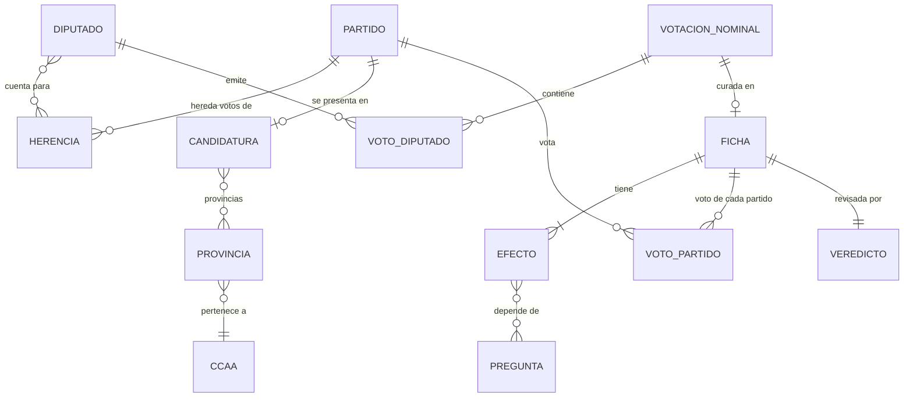

# Modelo de datos

<!-- Actualizar este archivo cada vez que se añada, modifique o elimine una entidad o relación.
     El agente de codificación debe consultar este archivo antes de tocar data/ o los esquemas. -->

No hay base de datos. Todos los datos son **archivos versionados en `data/`**, generados por el
pipeline local o escritos a mano, y validados con esquemas Zod (`src/content.config.ts` y
`scripts/data/esquemas.ts`) en cada build. Si un archivo no cumple su esquema, el build falla.

Hay tres tipos de datos:

- **Brutos** (`data/raw/`): copia literal de los datos abiertos del Congreso. Nunca se editan.
- **Derivados** (generados por scripts): voto por partido. Nunca se editan a mano.
- **Curados** (escritos por Claude y revisados por el jurado): partidos, candidaturas, preguntas,
  fichas del catálogo. Cada cambio pasa por un PR.

---

## Entidades principales

### Provincia — `data/territorio.yaml` (curado, estable)
| Campo | Tipo | Descripción |
|-------|------|-------------|
| id | slug | `valencia`, `a-coruna`… (52) |
| nombre | texto | Nombre oficial |
| ccaa | slug | Comunidad o ciudad autónoma a la que pertenece (19) |

### Partido — `data/partidos/partidos.yaml` (curado)
Las candidaturas que pueden aparecer en el resultado.
| Campo | Tipo | Descripción |
|-------|------|-------------|
| id | slug | `psoe`, `pp`, `vox`… |
| nombre | texto | Nombre con el que se presenta el 29-N-2026 |
| siglas | texto | Para filas estrechas |
| color | hex | Color oficial; único entre partidos (design-system) |
| logo | ruta | `public/logos/<id>.svg` |
| herencia | lista | Por legislatura, qué diputados heredan este partido (ver "Herencia") |

### Herencia de un partido (dentro de Partido)
Responde a "¿qué votos de la XIV y la XV cuentan como de este partido?". Hace falta porque los
diputados se eligen en coaliciones (Unidas Podemos, Sumar) y luego hay escisiones.
| Campo | Tipo | Descripción |
|-------|------|-------------|
| legislatura | `XIV` \| `XV` | |
| formaciones | lista de texto | Formaciones electorales de origen cuyos diputados cuentan |
| incluir / excluir | lista de ids de diputado | Excepciones (p. ej. diputados de Podemos tras salir de Sumar) |
| desde / hasta | fecha (opcional) | Si la herencia cambia a mitad de legislatura |
| justificacion | texto | Obligatorio; se muestra en "Cómo funciona" |

### Candidatura — `data/candidaturas/2026.yaml` (curado, a partir del BOE)
| Campo | Tipo | Descripción |
|-------|------|-------------|
| partido | id de Partido | |
| provincias | lista de ids de Provincia, o `todas` | Dónde se presenta |
| fuente | URL | Publicación del BOE |
| provisional | booleano | `true` hasta que se publiquen las candidaturas proclamadas |

Un partido sin candidatura en la provincia del visitante no aparece (M-02). Un partido sin
herencia en ninguna legislatura no puede tener candidatura (partido nuevo).

### Diputado — `data/partidos/diputados-<leg>.json` (derivado de los datos abiertos)
| Campo | Tipo | Descripción |
|-------|------|-------------|
| id | texto | Identificador del Congreso, o nombre normalizado si no hay id |
| nombre | texto | Como aparece en las votaciones |
| legislatura | `XIV` \| `XV` | |
| formacion | texto | Formación electoral por la que fue elegido |
| alta / baja | fecha | Periodo como diputado |

### Votación nominal — `data/raw/<leg>/<sesion>/<num>.json` (bruto)
| Campo | Tipo | Descripción |
|-------|------|-------------|
| legislatura, sesion, numero | | Identifican la votación en el Congreso |
| fecha | fecha | |
| titulo, expediente | texto | Tal como los publica el Congreso |
| votos | lista de { diputado, grupo, voto } | `Sí`, `No`, `Abstención`, `No vota` |

### Voto de partido — `data/votos/<leg>.json` (derivado por `pnpm data:votos`)
Una fila por votación del catálogo y partido con herencia en esa legislatura.
| Campo | Tipo | Descripción |
|-------|------|-------------|
| votacion | ref | legislatura + sesión + número |
| partido | id de Partido | |
| sentido | `si` \| `no` \| `abstencion` \| `ausente` | Voto de la mayoría de sus diputados presentes; `ausente` si no votó ninguno |
| dividido | booleano | Algún diputado votó distinto de la mayoría |
| desglose | { si, no, abstencion, ausente } | Recuento de sus diputados |

### Pregunta — `data/preguntas.yaml` (curado)
| Campo | Tipo | Descripción |
|-------|------|-------------|
| id | slug | `provincia`, `vivienda`, `trabajo`… |
| bloque | `basico` \| `ampliado` | Bloque del cuestionario (M-01) |
| orden | entero | Posición dentro del bloque |
| enunciado | texto | "¿Cómo trabajas?" |
| subtitulo | texto (opcional) | Solo si la pregunta puede generar dudas |
| tipo | `opciones` \| `provincia` | `provincia` usa el selector con panel |
| opciones | lista de { id, texto } | Siempre incluye `ns` ("Prefiero no responder"), salvo en `provincia` |
| obligatoria | booleano | Solo `provincia` |

El build falla si una pregunta no la usa ninguna ficha del catálogo (salvo `provincia`).

### Ficha del catálogo — `data/catalogo/<leg>-<sesion>-<num>.yaml` (curado)
| Campo | Tipo | Descripción |
|-------|------|-------------|
| votacion | ref | legislatura + sesión + número oficiales |
| url | URL | Página de la votación o de la iniciativa en congreso.es (obligatoria) |
| fecha | fecha | |
| titulo_oficial | texto | Literal del Congreso |
| titulo | texto | En lenguaje claro: "Ley de vivienda" |
| resumen | texto | Qué se votaba, en dos o tres frases |
| que_significa_si | texto | Qué implicaba votar "Sí" (en una enmienda a la totalidad, "Sí" es rechazar la ley) |
| tema | slug | `vivienda`, `empleo`, `familia`, `fiscalidad`, `territorio`… |
| ambito | `estatal` \| lista de ids de ccaa | Las territoriales solo cuentan en esas comunidades (M-11) |
| efectos | lista de Efecto | A qué perfiles afecta y cómo (ver abajo) |
| justificacion | texto | Por qué se ha elegido esta votación (obligatoria) |
| fuentes | lista de URL | BOE, Diario de Sesiones, nota oficial |

### Efecto (dentro de la Ficha)
| Campo | Tipo | Descripción |
|-------|------|-------------|
| cuando | condición | Sobre las respuestas: `{ vivienda: [alquiler] }`, `{ ccaa: [cataluna] }`; varias claves = todas se cumplen |
| el_si | `favorece` \| `perjudica` | Efecto de que saliera "Sí" para quien cumple la condición |
| justificacion | texto | Por qué; se muestra al visitante en M-04 (obligatoria) |

### Veredicto del jurado — `data/jurado/<ficha>.json` (derivado por `pnpm data:jurado`)
| Campo | Tipo | Descripción |
|-------|------|-------------|
| ficha | id de Ficha | |
| hash_ficha | texto | Hash del contenido revisado; si la ficha cambia, el veredicto caduca |
| veredictos | lista de { modelo, fecha, acuerdo: booleano, razones } | Uno por juez (cinco) |
| prompt | texto | Prompt exacto enviado |

El build falla si una ficha no tiene veredicto vigente o si 3 o más jueces discrepan (M-10).

---

## Relaciones entre entidades

---

## Cálculo de afinidad

Lo hace `src/lib/afinidad/` en el navegador. Para un visitante y un partido que se presenta en su
provincia:

1. **Votaciones relevantes:** las fichas cuyo `ambito` incluye su comunidad (o es estatal) y con
   al menos un efecto cuya condición cumplen sus respuestas. Una respuesta `ns` no cumple ninguna
   condición.
2. **Sentido para el visitante:** si los efectos que cumple coinciden, ese es el sentido. Si se
   contradicen (uno favorece y otro perjudica), la votación se excluye para él y se indica en la
   lista.
3. **Voto del partido:** con `el_si = favorece`, votar `si` es *a favor* y `no` es *en contra*; con
   `perjudica`, al revés. `abstencion` cuenta en el total pero no es ni a favor ni en contra.
   `ausente` excluye la votación para ese partido.
4. **Porcentajes (M-03):** favorable = a favor / votaciones contadas; desfavorable = en contra /
   votaciones contadas. Podio favorable: los 3 con más porcentaje favorable; desfavorable: los 3
   con más porcentaje desfavorable, sin repetir partido (M-03).
5. **Mínimo de datos:** con menos de 5 votaciones relevantes no se muestra podio (M-03).

---

## Validación y versionado

En lugar de migraciones:

- Los esquemas Zod son la fuente de verdad de cada formato. Un cambio de formato se hace en el
  esquema y en los datos en el mismo PR, y se registra en `changelog/`.
- `pnpm data:validar` ejecuta todas las comprobaciones cruzadas (referencias entre archivos,
  colores únicos, preguntas usadas, veredictos vigentes) y se lanza también en `pnpm build`.
- Nuevas legislaturas en futuras elecciones: se añade el valor al enum de `legislatura`, se
  descarga `data/raw/<leg>/` y se amplía la herencia de cada partido.

---

## Datos semilla

- `data/territorio.yaml`: 52 provincias y 19 comunidades y ciudades autónomas.
- `data/candidaturas/2026.yaml`: lista provisional hasta la publicación en el BOE de las
  candidaturas proclamadas; después, la definitiva.
- Para tests: `tests/fixtures/` con un catálogo mínimo inventado (partidos A–F, seis fichas) que
  no depende de los datos reales.
